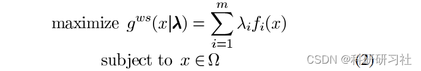
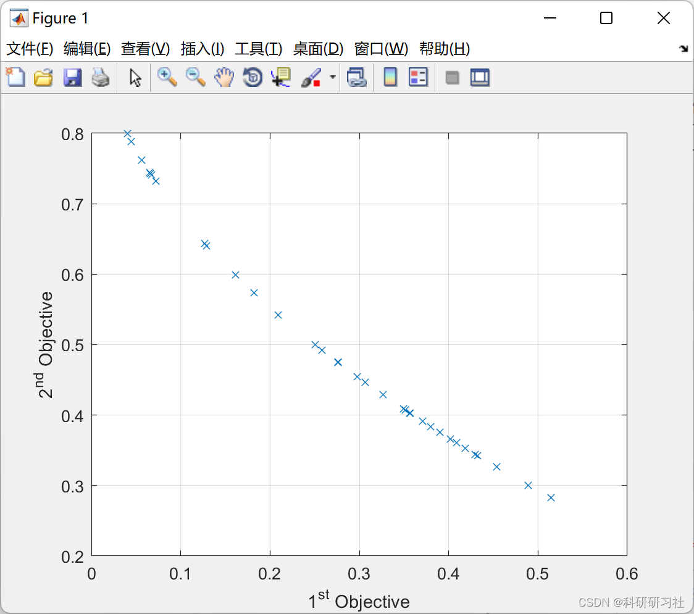
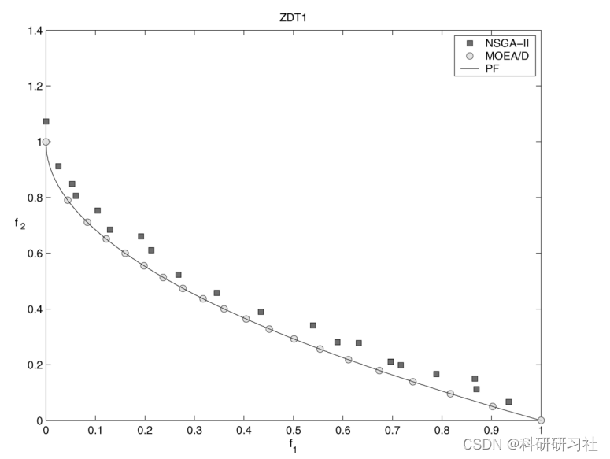

# Multi-objective Decomposition Multi-Objective Evolutionary Algorithm (MOEA/D) in Matlab

1. Overview
The Multiobjective Evolutionary Algorithm Based on Decomposition (MOEA/D) is an algorithm that utilizes decomposition strategies to solve multi-objective problems. This algorithm divides the multi-objective problem into N sub-problems through aggregation functions, assigning corresponding weights and neighborhoods of related population points to each sub-problem. The population iteration involves randomly selecting two parent points within the neighborhood to crossover and generate new offspring points, updating the reference point Z afterward. Subsequently, the algorithm compares the offspring points with the parent points using an aggregation method, updating all dominated points within the neighborhood, effectively utilizing local information to avoid getting trapped in local optima. Finally, the non-dominated solutions are stored in the external archive (external population, EP). MOEA/D employs the decomposition concept, solving each point (sub-problem) with a weight assigned to it. Since the weights are uniformly distributed across the objective space, MOEA/D ensures efficient computation while maintaining the uniform distribution of points compared to other algorithms.
Decomposition is a fundamental strategy in traditional multi-objective optimization. However, it has not been widely applied in multi-objective evolutionary optimization. This paper proposes a multi-objective evolutionary algorithm based on decomposition (MOEA/D). It decomposes the multi-objective optimization problem into multiple scalar optimization sub-problems and optimizes them simultaneously. Each sub-problem is optimized using information from several neighboring sub-problems, which makes MOEA / D have lower computational complexity than MOGLS and NSGA-II (Non-dominated Sorting Genetic Algorithm II) in each generation. Experimental results show that MOEA / D with simple decomposition methods outperforms MOGLS and NSGA-II or has similar performance to NSGA-II in the multi-objective 0-1 knapsack problem and continuous multi-objective optimization problems. Research indicates that using target normalization for MOEA / D can handle different proportions of objectives, while using advanced decomposition methods for MOEA / D can generate a set of uniformly distributed solutions for three-objective test instances. This paper also conducts experimental research on the capability of MOEA / D under small populations, scalability, and sensitivity of MOEA / D.
2 Mathematical Model Edit
Detailed model explanation can be found in Section 4.
3 Running Results Edit
​Edit
4 Matlab Code and Detailed Article This article only showcases part of the code, all codes can be found in:
\nclc;\nclear;\nclose all;\n\n%% Problem Definition\n\nCostFunction = @(x) ZDT(x);  % Cost Function\n\nnVar = 3;             % Number of Decision Variables\n\nVarSize = [nVar 1];   % Decision Variables Matrix Size\n\nVarMin = 0;         % Decision Variables Lower Bound\nVarMax = 1;         % Decision Variables Upper Bound\n\nnObj = numel(CostFunction(unifrnd(VarMin, VarMax, VarSize)));\n\n\n%% MOEA/D Settings\n\nMaxIt = 100;  % Maximum Number of Iterations\n\nnPop = 50;    % Population Size (Number of Sub-Problems)\n\nnArchive = 50;\n\nT = max(ceil(0.15*nPop), 2);    % Number of Neighbors\nT = min(max(T, 2), 15);\n\ncrossover_params.gamma = 0.5;\ncrossover_params.VarMin = VarMin;\ncrossover_params.VarMax = VarMax;\n\n%% Initialization\n\n% Create Sub-problems\nsp = CreateSubProblems(nObj, nPop, T);\n\n% Empty Individual\nempty_individual.Position = [];\nempty_individual.Cost = [];\nempty_individual.g = [];\nempty_individual.IsDominated = [];\n\n% Initialize Goal Point\n%z = inf(nObj, 1);\nz = zeros(nObj, 1);\n\n% Create Initial Population\npop = repmat(empty_individual, nPop, 1);\nfor i = 1:nPop\n    pop(i).Position = unifrnd(VarMin, VarMax, VarSize);\n    pop(i).Cost = CostFunction(pop(i).Position);\n    z = min(z, pop(i).Cost);\nend\n\nfor i = 1:nPop\n    pop(i).g = DecomposedCost(pop(i), z, sp(i).lambda);\nend\n\n% Determine Population Domination Status\npop = DetermineDomination(pop);\n\n% Initialize Estimated Pareto Front\nEP = pop(~[pop.IsDominated]);\n\n%% Main Loop\n\nfor it = 1:MaxIt\n    for i = 1:nPop\n        \n        % Reproduction (Crossover)\n        K = randsample(T, 2);\n        \n        j1 = sp(i).Neighbors(K(1));\n        p1 = pop(j1);\n        \n        j2 = sp(i).Neighbors(K(2));\n        p2 = pop(j2);\n        \n        y = empty_individual;\n        y.Position = Crossover(p1.Position, p2.Position, crossover_params);\n        \n        y.Cost = CostFunction(y.Position);\n        \n        z = min(z, y.Cost);\n        \n        for j = sp(i).Neighbors\n            y.g = DecomposedCost(y, z, sp(j).lambda);\n            if y.g <= pop(j).g\n                pop(j) = y;\n            end\n        end\n        \n    end\n    \n    % Determine Population Domination Status\n\tpop = DetermineDomination(pop);\n    \n    ndpop = pop(~[pop.IsDominated]);\n    \n    EP = [EP\n        ndpop]; %#ok\n    \n    EP = DetermineDomination(EP);\n    EP = EP(~[EP.IsDominated]);\n    \n    if numel(EP)>nArchive\n        Extra = numel(EP)-nArchive;\n        ToBeDeleted = randsample(numel(EP), Extra);\n        EP(ToBeDeleted) = [];\n    end\n    \n    % Plot EP\n    figure(1);\n    PlotCosts(EP);\n    pause(0.01);\n\n    \n    % Display Iteration Information\n    disp(['Iteration ' num2str(it) ': Number of Pareto Solutions = ' num2str(numel(EP))]);\n    \nend\n\n%% Reults\n\ndisp(' ');\n\nEPC = [EP.Cost];\nfor j = 1:nObj\n    \n    disp(['Objective #' num2str(j) ':']);\n    disp(['      Min = ' num2str(min(EPC(j, :)))]);\n    disp(['      Max = ' num2str(max(EPC(j, :)))]);\n    disp(['    Range = ' num2str(max(EPC(j, :))-min(EPC(j, :)))]);\n    disp(['    St.D. = ' num2str(std(EPC(j, :)))]);\n    disp(['     Mean = ' num2str(mean(EPC(j, :)))]);\n    disp(' ');\n    \nend\n\n\n  
Editor
5 References
[1] Wang Qixiang, Xu Feng. MOEA/D Algorithm Improved Based on Cooperative Evolutionary Strategy [J]. Science and Innovation and Application, 2021(4):24-27  
[2] Yi Lingzhi, Lin Jiahao, Liu Jiankang, Luo Xianguang, Li Wang. Optimization of Building Load Scheduling Based on Improved Adaptive MOEA/D Algorithm [J]. Computer Engineering and Application, 2022, 58(2):295-302  
[3] Zhang Q. and Li H., "MOEA/D: A Multiobjective Evolutionary Algorithm Based on Decomposition," in IEEE Transactions on Evolutionary Computation, vol. 11, no. 6, pp. 712-731, Dec. 2007, doi: 10.1109/TEVC.2007.892759.

## Images

<!-- PAYMENT_BLOCK -->

## Get this dataset

- Payment link (Stripe): [Buy now](https://buy.stripe.com/3cs8yP7sY87d0vu9AB)
- Payment QR code: 

<!-- /PAYMENT_BLOCK -->
